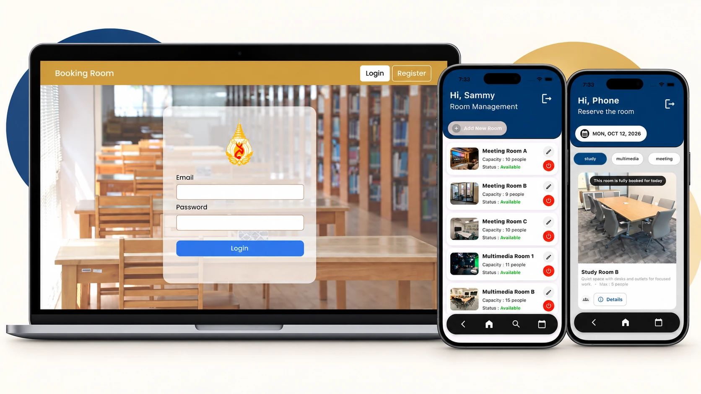
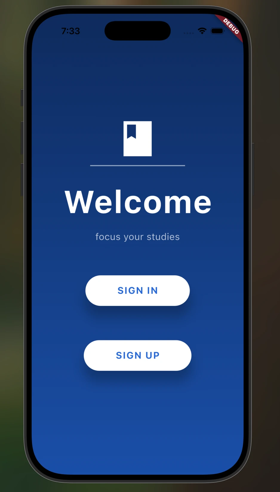
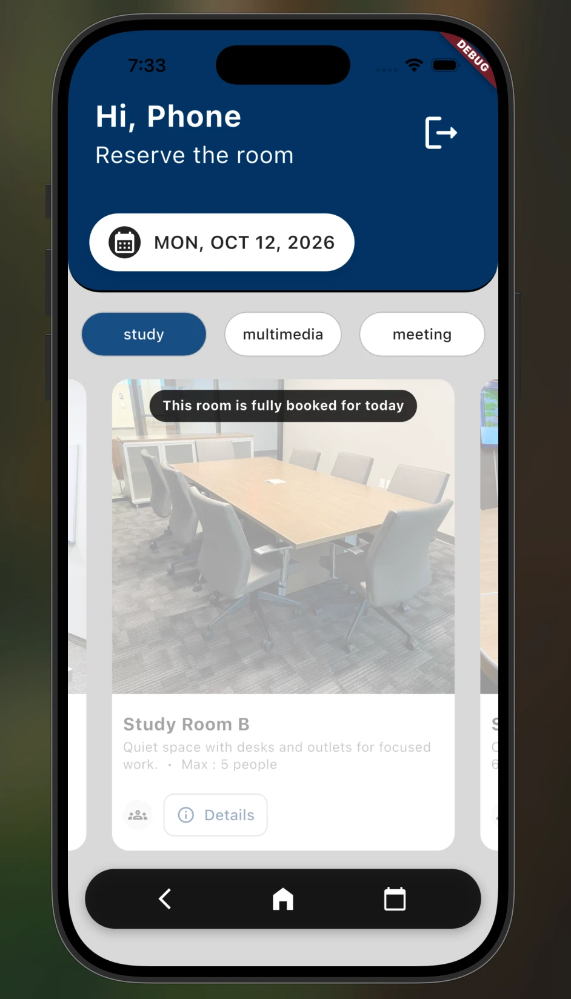
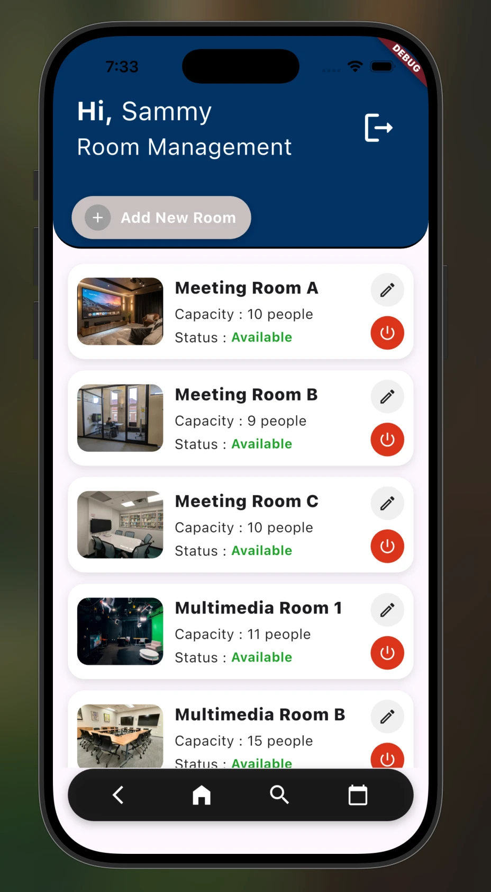
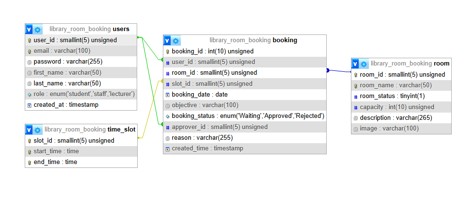

# Library Room Booking

A Flutter app for booking university library rooms, with the REST API that
backs it. Students request a room for a fixed time slot, lecturers approve or
reject those requests, and library staff manage the rooms themselves.

The repository holds both halves of the system:

| Directory | What it is                                                      |
| --------- | --------------------------------------------------------------- |
| `app/`    | Flutter client for Android and iOS                               |
| `server/` | Node.js and Express REST API with JWT auth, backed by MySQL      |

<p align="center">
  
</p>

<p align="center">
  <sub>The Flutter client on the right. The same booking model also exists as a
  web app, in
  <a href="https://github.com/Zenzee7711/library-room-reservation-web">library-room-reservation-web</a>.</sub>
</p>

## Contents

- [Features](#features)
- [Screenshots](#screenshots)
- [How it works](#how-it-works)
- [Tech stack](#tech-stack)
- [Architecture](#architecture)
- [Database](#database)
- [Getting started](#getting-started)
- [API reference](#api-reference)
- [Security notes](#security-notes)
- [Known limitations](#known-limitations)

## Features

**Student**

- Register and sign in; the session token is held in encrypted device storage
- Browse rooms for a chosen date, with each slot marked available, pending,
  reserved, passed or disabled
- Request a room for a slot, with a stated objective
- Track request status and read the lecturer's reason when one is rejected

**Lecturer**

- Dashboard summarising how the day's slots are allocated
- Queue of pending requests, approved in one tap or rejected with a reason
- History of the decisions this lecturer has made

**Library staff**

- Dashboard summarising slot usage
- Create rooms, edit details and upload or replace room photos from the camera
  or the device's files
- Take rooms offline and back online, blocked while a room still has active
  bookings
- Read-only view of every pending and decided booking

## Screenshots

<p align="center">
  
  
  
</p>

<p align="center">
  <sub>Welcome &nbsp;&middot;&nbsp; student booking &nbsp;&middot;&nbsp; staff room management</sub>
</p>

One sign-in screen serves all three roles. Which home screen it opens comes from
the `role` the API reports for the account, so the student above and the staff
member beside them are the same build of the same app.

## How it works

Two processes, and only one of them ever touches the database:

```
Flutter app  (app/)
  |      JSON over HTTP, Authorization: Bearer <token>
  v
Express API  (server/src/app.js)
  |-- middleware/auth.js     verifies the JWT, puts the user id and role on the request
  |-- route modules          role check, then JSON in and JSON out
  v
mysql2 connection pool  (server/src/config/db.js)
  |
  v
MySQL   library_room_booking
```

The app holds no database credentials and contains no SQL. It knows a single
host, `ApiConfig.baseUrl` in `app/lib/config/api_config.dart`, and a token;
everything else arrives as JSON. That split is what lets one build run against
an emulator, a simulator or a phone on the local network without editing any
screen's source.

Signing in sends the email and password once. The API verifies them against the
argon2id hash in `users.password` and returns a JWT carrying the user id and
role, good for seven days. The app keeps it in `flutter_secure_storage` and
attaches it to every later request, so the password is never stored on the
device, and the identity a booking is filed under is read from the token rather
than from the request body.

Room photos follow the same rule. The API returns a relative path such as
`/uploads/room.jpg` and the app expands it against the same base URL through
`ApiConfig.resolveUrl`, so no host name is ever baked into a database row.

## Tech stack

| Layer      | Technology                                        |
| ---------- | ------------------------------------------------- |
| Client     | Flutter 3.8+, Dart                                 |
| HTTP       | `http`                                             |
| Storage    | `flutter_secure_storage` for the token, `shared_preferences` for display settings |
| Media      | `image_picker`, `file_picker`                      |
| API        | Node.js 18+, Express 5                             |
| Database   | MySQL 8 / MariaDB 10.4, accessed with `mysql2`     |
| Auth       | JWT bearer tokens, argon2id password hashing       |
| Uploads    | `multer`, restricted by MIME type and file size    |

## Architecture

```
app/lib/
├── main.dart                 App entry point
├── config/api_config.dart    Base URL (build-time) and URL resolution
├── pages/                    Welcome, sign in, sign up
├── student_*.dart            Student browsing and history
├── lecturer_*.dart           Lecturer dashboard, approvals, history
├── staff_*.dart              Staff dashboard, room management, add and edit
└── logout_function.dart      Shared sign-out

server/src/
├── server.js                 Process entry point and graceful shutdown
├── app.js                    Express app, middleware chain, error handling
├── config/
│   ├── env.js                Reads and validates environment variables
│   ├── db.js                 MySQL connection pool and query helper
│   └── constants.js          Timezone and booking statuses
├── lib/time.js               Timezone-aware "today" and current time
├── middleware/
│   ├── auth.js               JWT signing, requireAuth, requireRole
│   └── upload.js             Multer storage, limits and public paths
└── routes/
    ├── auth.routes.js        Register, login, token check
    ├── rooms.routes.js       Time slots and the availability grid
    ├── student.routes.js     Booking requests and student history
    ├── lecturer.routes.js    Approval queue, approve, reject, history
    └── staff.routes.js       Room CRUD, photo upload, booking overview

server/database/
├── schema.sql                Tables, keys and foreign keys
└── seed.sql                  Demo rooms and time slots
```

## Database

MySQL, four tables. Only `booking` carries foreign keys: it is the junction that
ties a person, a room and a time of day to a date.

<p align="center">
  
</p>

### What each table holds

| Table       | One row is                      | Worth knowing                                                                                         |
| ----------- | ------------------------------- | ------------------------------------------------------------------------------------------------------- |
| `users`     | an account                      | `email` is unique; `role` is `student`, `lecturer` or `staff`, and decides what the account can reach     |
| `room`      | a bookable room                 | `room_status` is 1 for bookable, 0 for taken offline by staff; `image` holds a filename, not a path       |
| `time_slot` | one of the fixed daily periods  | seeded with four: 08-10, 10-12, 13-15, 15-17. A slot belongs to the day, not to any particular room      |
| `booking`   | one request for a room and slot | carries the status, the stated objective, the deciding lecturer and, on a rejection, the reason           |

### How they link

`room` and `time_slot` never reference one another. Every room is bookable in
every slot, so the grid each screen draws is simply their cross product,
`room` by `time_slot`, and a row in `booking` is what claims one cell of that
grid for one date.

- `booking.user_id` to `users.user_id` - who asked.
- `booking.room_id` to `room.room_id` - which room.
- `booking.slot_id` to `time_slot.slot_id` - which period of the day.
- `booking.approver_id` to `users.user_id` - the lecturer who decided it, `NULL`
  while the request is still `Waiting`. This is a second foreign key into
  `users`, which is why the diagram draws two lines between the same pair of
  tables.

A reservation is therefore identified by `(room_id, slot_id, booking_date)`, and
`booking_status` says whether the row actually holds that cell: it starts
`Waiting` and a lecturer moves it to `Approved` or `Rejected`, filling in
`reason` when rejecting so the student is told why. The composite index
`idx_booking_room_slot_date` exists for exactly that lookup, because almost
every screen performs it.

Nothing is ever deleted. A room goes offline through `room_status` instead of a
`DELETE`, so an old booking still resolves to a real room long after that room
stops being bookable.

### Working out what is free

`GET /common/rooms/availability?date=YYYY-MM-DD` runs three small queries in
parallel rather than one joined query, and assembles the grid in JavaScript:

```sql
SELECT room_id, room_name, room_status, description, image, capacity
  FROM room ORDER BY room_name;

SELECT slot_id, start_time, end_time FROM time_slot ORDER BY slot_id;

SELECT room_id, slot_id, booking_status
  FROM booking
 WHERE booking_date = ? AND booking_status IN ('Waiting', 'Approved');
```

Only live bookings come back from the third query, so a rejected request leaves
no mark on the grid. Each cell is then resolved in order: a room with
`room_status = 0` reads *disabled* whatever its bookings say; otherwise a
`Waiting` booking reads *pending* and an `Approved` one *reserved*; a slot whose
start time has already gone by, on today's date only, reads *passed*; anything
left reads *available*.

Because the date is a parameter rather than `CURDATE()`, this one endpoint also
serves the date picker at the top of the student screen.

Two rules are checked again when a request is actually submitted, since the grid
the app is holding may be seconds out of date:

1. the `(room, slot, date)` cell must not already hold a `Waiting` or `Approved`
   booking, and
2. the student must not already have an active booking that day, one room per
   student per day.

Both are checks rather than database constraints, which is the race noted under
[Known limitations](#known-limitations).

## Getting started

### Prerequisites

- Node.js 18 or newer
- MySQL 8 or MariaDB 10.4 (XAMPP works)
- Flutter 3.35 or newer
- **JDK 21** for the Android build, and an Android SDK with platform 36

On the JDK: recent Android Studio releases bundle Java 25, which Gradle 8.x
refuses to run on. If the Android build fails complaining about the Java
version, point Flutter at a JDK 21 instead:

```bash
flutter config --jdk-dir="/path/to/jdk-21"
```

The Android toolchain this builds against is Gradle 8.14.3, Android Gradle
Plugin 8.11.1 and Kotlin 2.3.20.

### 1. Start the API

```bash
cd server
npm install

mysql -u root -p < database/schema.sql
mysql -u root -p < database/seed.sql

cp .env.example .env
```

Fill in your MySQL credentials and set `JWT_SECRET` to a long random string:

```bash
node -e "console.log(require('crypto').randomBytes(32).toString('hex'))"
```

Then:

```bash
npm run dev
```

The API listens on `http://localhost:3000`. `GET /health` confirms it is up.

### 2. Run the app

The app needs to reach the API, and the right host depends on where it runs:

| Target           | `API_BASE_URL`                        |
| ---------------- | ------------------------------------- |
| iOS simulator    | `http://localhost:3000` (the default) |
| Android emulator | `http://10.0.2.2:3000`                |
| Physical device  | `http://<your machine's LAN IP>:3000` |

```bash
cd app
flutter pub get
flutter run --dart-define=API_BASE_URL=http://10.0.2.2:3000
```

Nothing else in the app hardcodes a host: every request goes through
`ApiConfig`, and room image paths returned by the API are resolved against the
same base URL.

### 3. Create accounts

The seed data contains rooms and time slots but no users, because passwords are
argon2id hashes generated by the API.

Register a student in the app. To try the lecturer and staff screens, register
two more accounts and promote them:

```sql
USE library_room_booking;
UPDATE users SET role = 'lecturer' WHERE email = 'lecturer@example.com';
UPDATE users SET role = 'staff'    WHERE email = 'staff@example.com';
```

Registration always creates a student, so an account cannot grant itself
approval rights.

### Tests

```bash
cd app
flutter test
```

## API reference

Every endpoint except register and login expects `Authorization: Bearer <token>`.

| Method | Endpoint                          | Role      | Purpose                                 |
| ------ | --------------------------------- | --------- | --------------------------------------- |
| POST   | `/api/register/create`            | public    | Register a student, returns a token      |
| POST   | `/api/login`                      | public    | Sign in, returns a token                 |
| GET    | `/common/user_auth`               | any       | Confirm a stored token is still valid    |
| GET    | `/health`                         | public    | Liveness check                           |
| GET    | `/time-slots`                     | any       | The bookable time slots                  |
| GET    | `/common/rooms/availability`      | any       | Room grid for `?date=YYYY-MM-DD`         |
| POST   | `/student/bookings`               | student   | Submit a booking request                 |
| GET    | `/student/bookings/history`       | student   | The student's own requests               |
| GET    | `/lecturer/bookings/pending`      | lecturer  | Requests awaiting a decision             |
| POST   | `/lecturer/bookings/:id/approve`  | lecturer  | Approve a request                        |
| POST   | `/lecturer/bookings/:id/reject`   | lecturer  | Reject a request with a reason           |
| GET    | `/lecturer/bookings/history`      | lecturer  | Decisions made by this lecturer          |
| GET    | `/staff/bookings/pending`         | staff     | All pending requests                     |
| GET    | `/staff/bookings/history`         | staff     | All decided requests                     |
| GET    | `/staff/rooms/management`         | staff     | Rooms with active booking counts         |
| POST   | `/staff/rooms/create`             | staff     | Create a room                            |
| POST   | `/staff/rooms/:id/edit`           | staff     | Update name, description, capacity       |
| POST   | `/staff/rooms/:id/toggle`         | staff     | Enable or disable a room                 |
| POST   | `/rooms/:id/image`                | staff     | Upload or replace a room photo           |

## Security notes

- **Identity comes from the token, never the request body.** A booking is filed
  against the caller's own user id and an approval is recorded against the
  lecturer's, so a client cannot act as somebody else by editing a payload.
- **Registration cannot escalate.** The endpoint ignores any role sent by the
  client and never accepts a pre-computed password hash.
- **Approve and reject are idempotent.** Both narrow the `UPDATE` to rows still
  `Waiting`, so a request cannot be decided twice and one lecturer cannot
  silently overwrite another's decision.
- **Passwords are argon2id hashes**, never stored or transmitted in the clear.
- **Uploads are constrained** by MIME type and an 8 MB limit, stored under
  generated names rather than the name the client supplied.
- Secrets live in `.env`, which is git-ignored; `.env.example` documents the
  shape without the values.

## Known limitations

- **Booking conflicts are checked, not locked.** Availability is verified
  immediately before the insert, so two requests arriving in the same instant
  could both pass. The next step would be a transaction with
  `SELECT ... FOR UPDATE`.
- **No token refresh.** Tokens last seven days; when one expires the user signs
  in again.
- **Test coverage is thin.** The Flutter tests cover start-up and URL
  resolution; the API has none.
- **Uploaded images are served from local disk**, which does not survive a
  redeploy on an ephemeral filesystem. Object storage would be the fix.

## Project context

Originally built for a university mobile development course, as a team project.
This repository is my own cleaned-up version of that work, published with the
team's coursework artefacts left out.

What changed between the coursework version and this one:

- The JWT signing secret, database credentials and CORS policy moved out of
  source into `.env`; the secret in the original was the placeholder string
- `http://localhost:3000`, previously repeated in 13 screens, reduced to one
  build-time setting, so the app runs against an emulator or a device without
  editing source
- Room image URLs made relative and resolved on the client, instead of the
  server baking `localhost` into every response
- The room photo upload endpoint given a staff role check; it previously had no
  authentication at all
- Availability and time slot endpoints moved behind authentication
- Both halves split into modules, and the API moved to a `mysql2` pool
- Default Flutter scaffolding replaced: package name, application id, launcher
  label, and a widget test that referenced a `MyApp` class the project does not
  have, so `flutter test` could not compile

## License

MIT — see [LICENSE](LICENSE).
